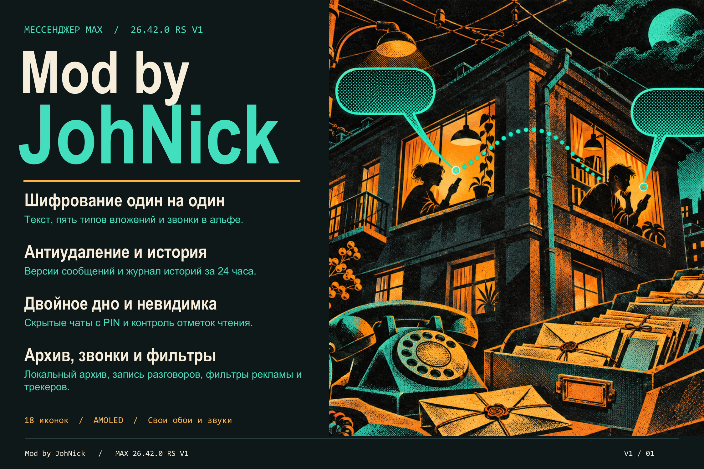

# MAX Mod by JohNick

Модифицированная сборка мессенджера **MAX** (`ru.oneme.app`) с набором пользовательских настроек приватности, локальных функций и точечных изменений поведения.

> Проект создан для учебных и исследовательских целей в области информационной безопасности. APK статически перепатчены и подписаны ключом разработчика. Описанные ниже меры относятся только к проверенным локальным точкам текущей базы MAX; они не означают полного отключения сбора данных или защиты от всех угроз.

📦 [**Скачать последнюю сборку →**](../../releases/latest)

---

## Описание версии **26.42.0 RS V1**

Дата выпуска: **27 ноября 2026**.

Первый крупный релиз на базе **MAX 26.42.0 RS** (сборка `6936`, 5-DEX архитектура):
- **Полноэкранное меню и «Классика» + 3-режимный бэкап:** компактный интерфейс с 7 категориями в 2-строчной сетке, возвратом к классическому меню, 100% сохранностью флагов при перезапуске и экспортом/импортом в 3 режимах (настройки мода, стоковые настройки MAX или оба набора без токенов, E2E-ключей и PIN-кодов).
- **Приватность, подмена номера, PIN-защита и «Двойное дно»:** скрытие или свой фиктивный номер в профиле (показ настоящего на 5 секунд по нажатию), PIN на приложение с непрозрачной шторкой, автоблокировкой при выключении экрана/сворачивании и авторазблокировкой по вводу PIN, PIN на настройки и отдельные чаты/группы/каналы с авторазблокировкой, скрытые чаты «Двойного дна» с обязательным PIN и скрытием из поиска контактов, гранулярная античиталка, обход `FLAG_SECURE`, блокировка рекламы и трекеров/проб TG/WA.
- **Антиудаление, истории (24ч), E2E и 20 UX-возможностей:** локальное удержание удалённых сообщений (включая «Стереть переписку»), антиудаление и история изменений историй за 24 часа, настраиваемые метки и цвета, лимит базы, детали сообщения, предпросмотр и 1-тап фильтры списка чатов, свайп-действия, частичное копирование, избранные сообщения, переход по дате, глобальное скрытие клавиатуры при прокрутке вверх (включая Android 14/15), размер шрифта и пузырей, быстрые ответы (`/`), пересылка без автора, подтверждение звонков/стикеров, позиция и скорость голосовых (`1x/1.5x/2x`), AMOLED `#000000`, авто-ночной режим, видеообои, 18 иконок и сквозное шифрование 1:1.

**Границы проверки:** `4/4` APK собраны (`39/39` шагов) и подписаны v2+v3 (`arm64`/`arm7`, основной и клон), `11/11` статических гейтов и матрица покрытия (`42/42`, `153` тумблера) пройдены (`PASS`); на эмуляторе выполнены полная проверка (`49/49`, `152/152`, `11/11`) и целевая повторная проверка финальной сборки (`PASS`, `0` крашей/ошибок верификации). Приёмка на физическом смартфоне (S25) и нативном 32-битном `arm7`-устройстве выполняется отдельно.

Полный перечень изменений — в [CHANGELOG](./CHANGELOG.md) и [примечаниях к выпуску](./RELEASE_NOTES_v26.42.0.1.md). Обзорные материалы: [постер](./docs/promo/poster.png), [17 карточек инфографики](./docs/promo/CARDS.md) и [мобильный PDF](./docs/promo/Mod_by_JohNick_26.42.0_V1_mobile.pdf).

**Базовый APK:** MAX 26.42.0 RS (сборка `6936`). Варианты `arm64`/`arm7` и основной/`clone` доступны в релизе.
### Какой APK выбрать

- Для большинства современных устройств — `arm64`.
- Для 32-битных устройств — `arm7`.
- Вариант `clone` устанавливается рядом с основным приложением под отдельным package ID (`ru.oneme.ap2`).

## Защиты и границы покрытия

Ниже перечислены подтверждённые категории изменений текущей линии мода. Это перечень охваченных точек, а не гарантия, что MAX вообще не собирает соответствующие данные.

### Точки защиты, внесённые модом

- **Телеметрия и SDK:** заглушены отдельные отправители/инициализаторы AppTracer/Tracer, CallAnalyticsSender, DPS/TraceFlow, DailyAnalyticsWorker, AnrWatcher, а также точки MyTracker и OneLog (их библиотеки остаются в APK).
- **WebApp / мини-приложения:** блокируется передача MSISDN/phone-hash и мост `AndroidPerf`; доступ мини-приложений к DeviceStorage/SecureStorage блокируется отдельным тумблером (по умолчанию OFF); блокируются запросы трекеров внутри WebView.
- **Сеть и медиа:** пресекаются пробы доступности Telegram/WhatsApp (`t.me`, `whatsapp.net`) и аналитика (`apptracer`, `vk-analytics`, `trace-flow.ru`, `stats-dg.rustore.ru`); фильтруется известный публичный `srflx` IP-кандидат в WebRTC; GPS-координаты EXIF обнуляются в проверенном пути.
- **PMS / системная телеметрия:** в известных путях снижены `log-full`, `log-sensitive`, `log-violations`, `log-messages-meta`, `log-chat-meta`, `pmb`/`pmb-log`, `calls-sdk-webrtc-logs` и `mytracker-enabled`; TLS-проверка принудительно включается; DoH, отправка локации и host-reachability выключаются.
- **Локальные пользовательские настройки:** синхронизация адресной книги по умолчанию блокируется; доступны подмена/скрытие номера в профиле, PIN-защита, «Двойное дно», режимы скрытия набора, гранулярная античиталка, скрытие присутствия и просмотра историй, история изменений обычных сообщений и 3-режимный бэкап настроек через системный выбор файлов.
- **E2E:** поддерживаемые личные чаты 1:1 (текстовые сообщения, 1:1 аудио-/видеозвонки и 5 типов вложений) при включённом глобальном E2E и ручном режиме чата; по сети текст зашифрованных push-уведомлений не передаётся открытым (при активной сессии превью расшифровывается локально с «🔒», без сессии шифротекст скрыт). Группы и каналы E2E модом не защищаются.

### Открытые, частичные и непроверенные угрозы

- Физическая приёмка на смартфоне (S25) и нативном 32-битном `arm7`-устройстве выполняется отдельно от эмулятора.
- NFC HCE и placeholder разрешения `REQUEST_INSTALL_PACKAGES` в ForceUpdate.
- Остальные потребители `connection_type`; список сетевых endpoint’ов не исчерпывающий.
- MAX сохраняет прочие SDK, отправители, сетевые пути и серверную обработку данных; аудит локальных патчей не доказывает отсутствие иных сборщиков или обходов.

Полный план и границы описаны в [SECURITY.md](./SECURITY.md), [MOD_GUIDE.md](./MOD_GUIDE.md), [E2E_GUIDE.md](./E2E_GUIDE.md) и примечаниях к конкретному релизу.

## История версий

- **26.42.0 RS V1** — первый крупный релиз на базе MAX 26.42.0 RS (6936, 5-DEX): полноэкранное и классическое меню («Классика»), 3-режимный бэкап, подмена/скрытие номера, полная PIN-защита (непрозрачная шторка, автоблокировка при выключении экрана, авторазблокировка по PIN приложения и чатов), «Двойное дно» со скрытием из поиска, антиудаление и история правок сообщений и историй (24ч), усиленная блокировка рекламы и трекеров, 20 новых UX-возможностей (включая глобальное скрытие клавиатуры при прокрутке на Android 14/15), AMOLED `#000000`, авто-ночной режим, видеообои, 18 иконок и E2E 1:1.

Полная история — в [CHANGELOG](./CHANGELOG.md).
