# Мобильная инфографика Mod by JohNick — MAX 26.42.0 RS V1

> Полный каталог в PDF для просмотра на телефоне: [Mod_by_JohNick_26.42.0_V1_mobile.pdf](./Mod_by_JohNick_26.42.0_V1_mobile.pdf)  
> Промопостер: [poster.png](./poster.png)

*Примечание: инфографика иллюстрирует состав возможностей линейки 26.42.0 RS V1; актуальный статус проверки конкретной сборки и известные ограничения указаны в [примечаниях к выпуску](../../RELEASE_NOTES_v26.42.0.1.md).*

---

## 1. Обзор
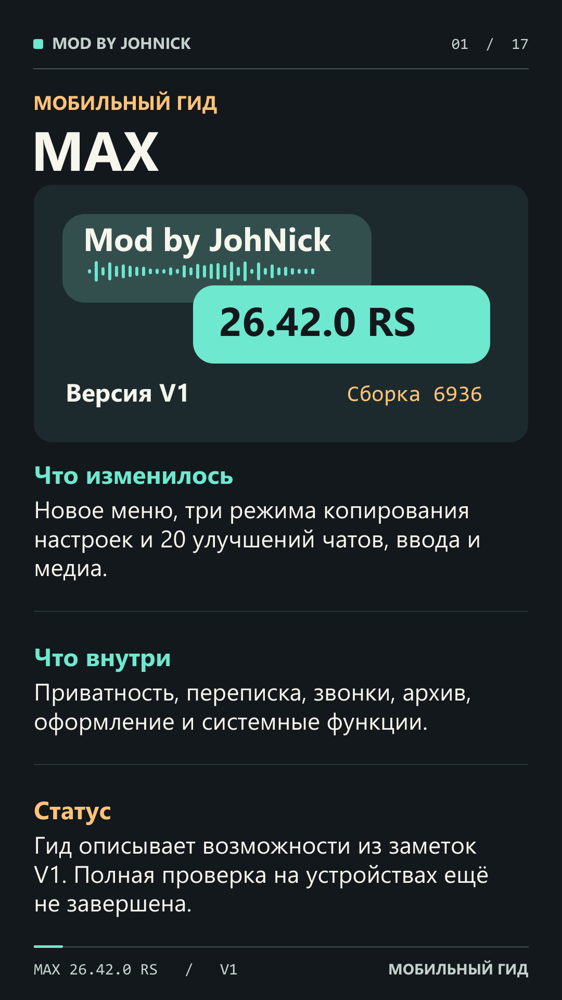

## 2. Настройки
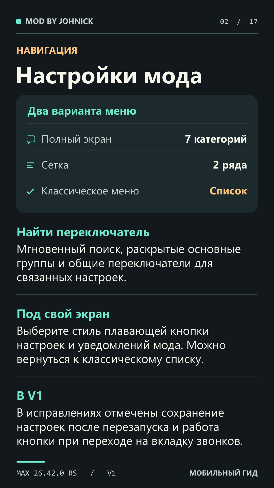

## 3. История правок
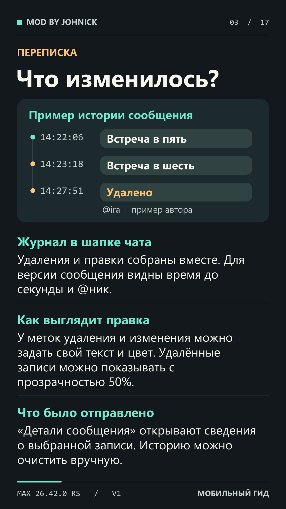

## 4. Антиудаление
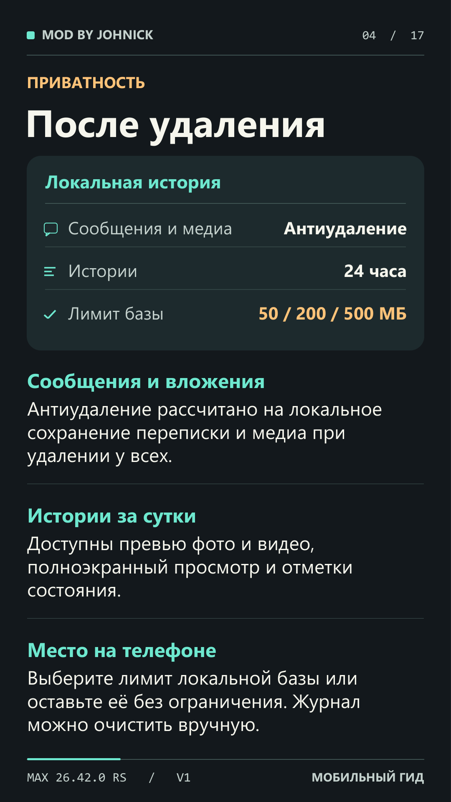

## 5. Невидимка
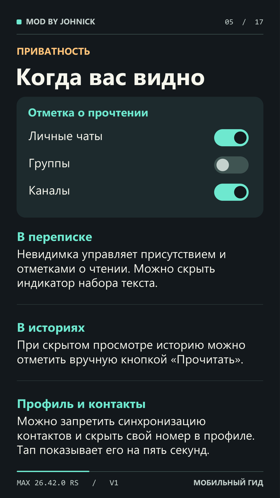

## 6. Двойное дно
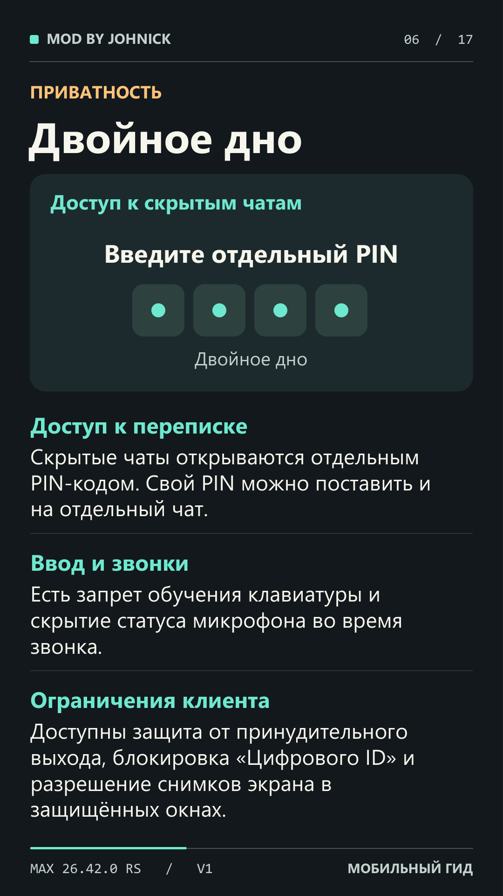

## 7. Шифрование
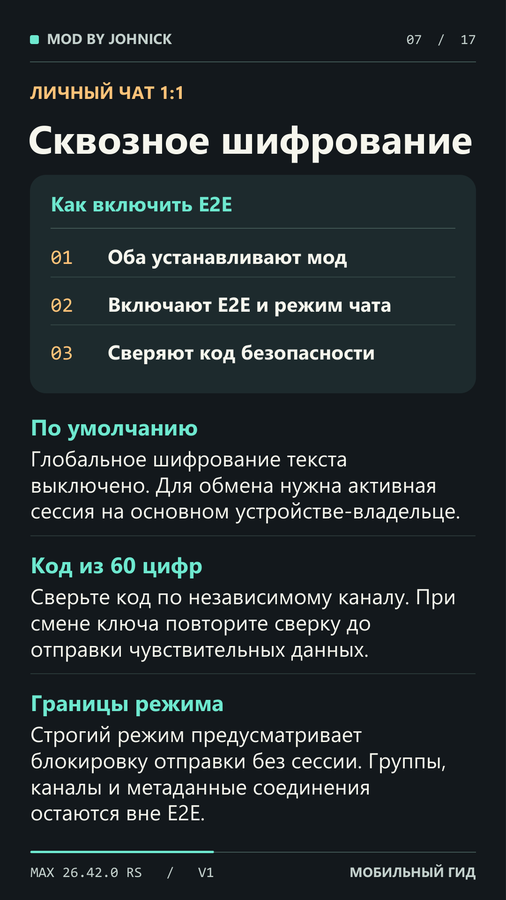

## 8. Защищённые медиа
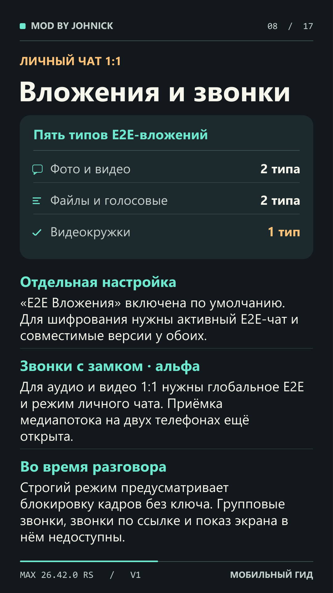

## 9. Архив и вкладки
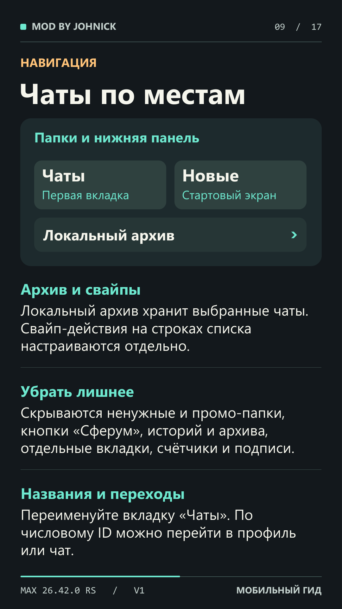

## 10. Фильтры
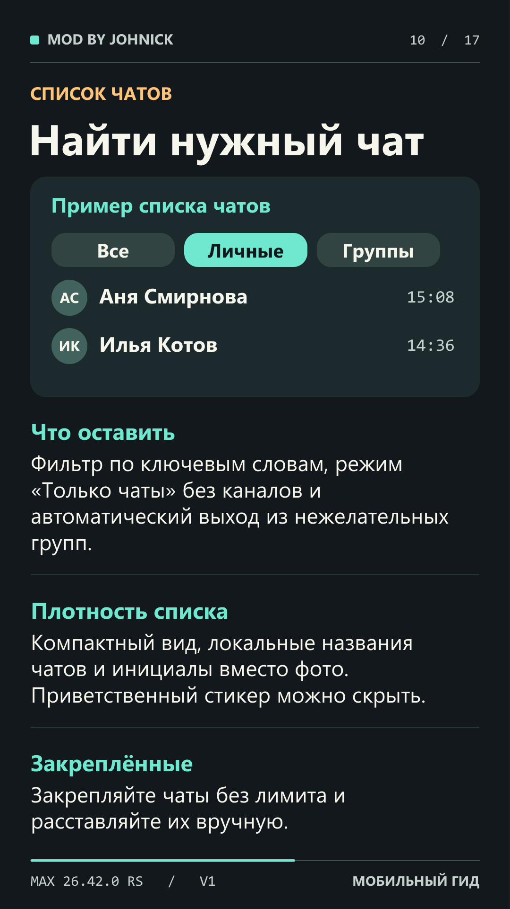

## 11. Реклама и трекеры
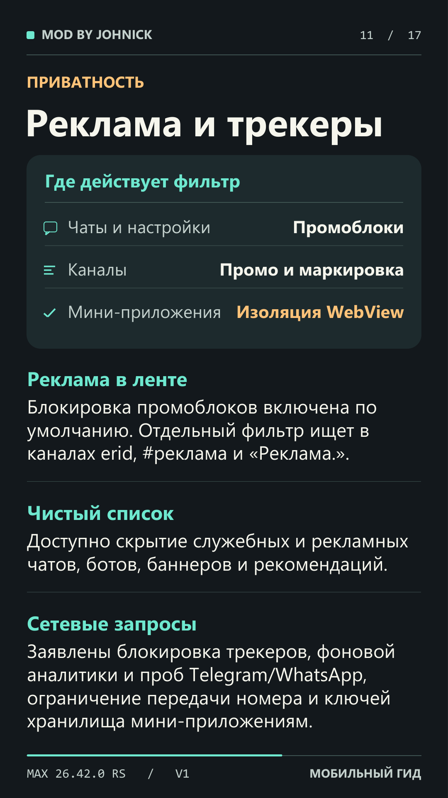

## 12. Действия в чате
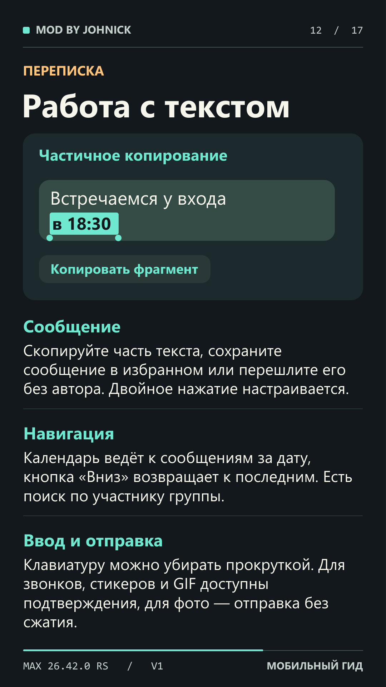

## 13. Медиа и звонки
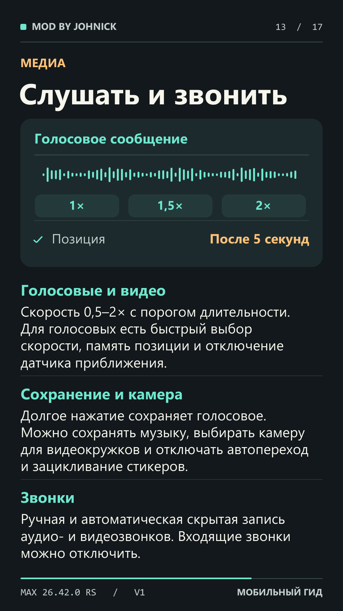

## 14. Оформление
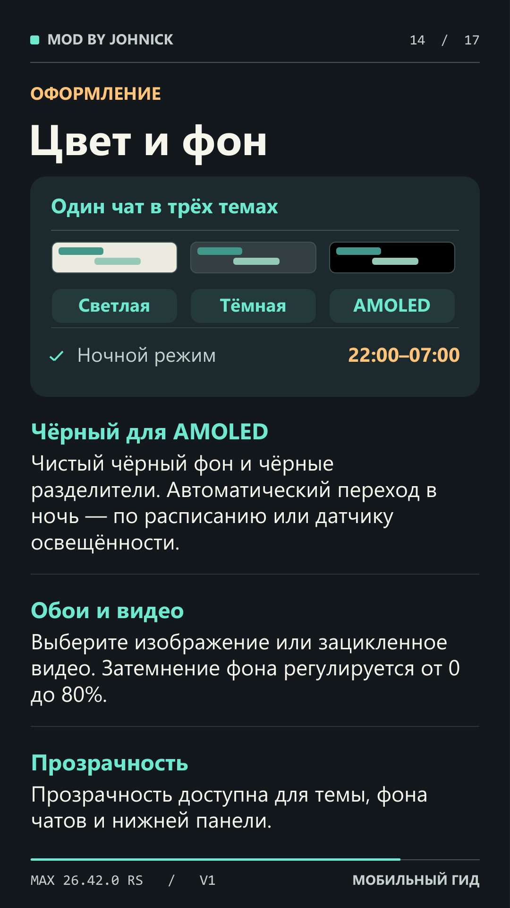

## 15. Детали интерфейса
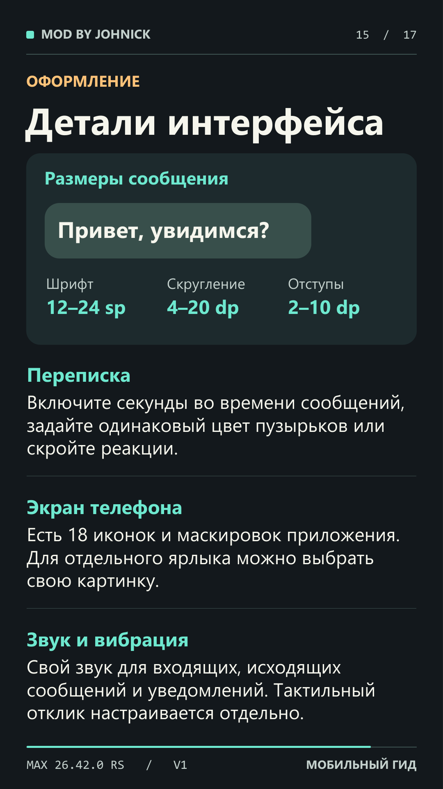

## 16. Резервная копия
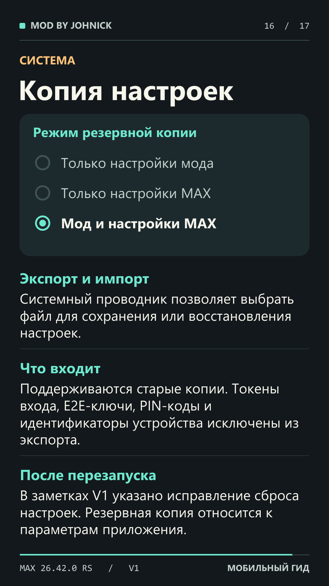

## 17. Система
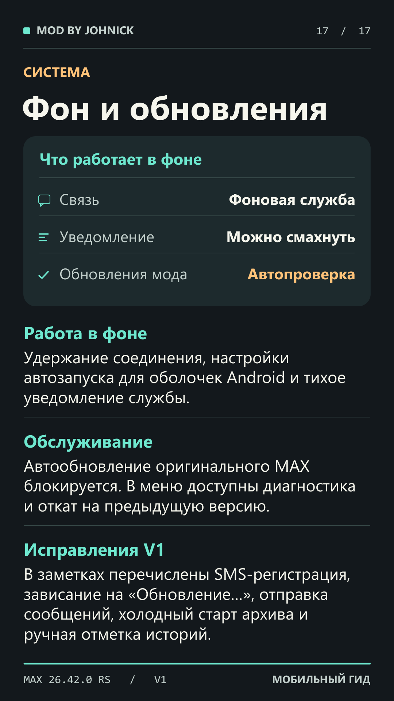
